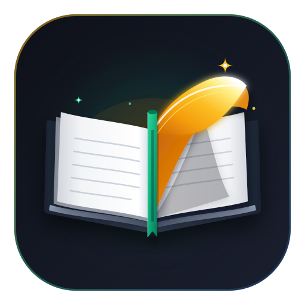

# 📖 RealBook Reader - Trải Nghiệm Đọc Sách Chân Thực

<p align="center">
  
</p>

<p align="center">
  <b>Ứng dụng đọc sách chuyên nghiệp mang lại trải nghiệm giống sách thật nhất có thể.</b><br/>
  Thiết kế tối giản, hiện đại (Zen Mode), tập trung tuyệt đối vào việc đọc với hiệu ứng lật trang 3D uốn lượn, bảo vệ mắt và kết nối kho sách mở hơn 70.000+ tác phẩm thế giới & Việt Nam.
</p>

<p align="center">
  
  
  
</p>

---

## 📥 TẢI XUỐNG ỨNG DỤNG (DOWNLOAD)

| Nền tảng | Định dạng | Tải về trực tiếp | Ghi chú |
| :--- | :--- | :--- | :--- |
| 🖥️ **Windows Desktop** | `.exe` (Installer) | [⬇️ **Tải RealBook Reader Setup 1.0.0.exe**](https://github.com/pytago02/RealBook-Reader/releases/download/v1.0.0/RealBook.Reader.Setup.1.0.0.exe) | Bộ cài đặt đầy đủ có shortcut Desktop & Start Menu |
| ⚡ **Windows Portable** | `.exe` (Portable) | [⬇️ **Tải RealBook Reader 1.0.0.exe**](https://github.com/pytago02/RealBook-Reader/releases/download/v1.0.0/RealBook.Reader.1.0.0.exe) | Chạy ngay không cần cài đặt (tiện dùng trên USB) |
| 📱 **Android Mobile** | `.apk` (Package) | [⬇️ **Tải RealBook-Reader.apk**](https://github.com/pytago02/RealBook-Reader/releases/download/v1.0.0/RealBook-Reader.apk) | Cài đặt trực tiếp cho điện thoại & máy tính bảng Android |
| 📦 **Tất cả phiên bản** | Releases Page | [🌐 **Xem danh sách GitHub Releases**](https://github.com/pytago02/RealBook-Reader/releases/latest) | Xem changelog và tất cả file đính kèm |

---

## ✨ CÁC TÍNH NĂNG NỔI BẬT

### 1. 🖐️ Nắm Chuột Lật Trang 3D & Cuộn Dòng Đa Năng
- **Nắm chuột cuộn dòng trong trang (Grab-to-Scroll):** Nhấn giữ chuột và kéo theo chiều dọc (lên/xuống) để cuộn dòng đọc tiếp một cách mượt mà và tự nhiên, tương tự công cụ Hand Tool chuyên nghiệp.
- **Nắm chuột lật trang 2 chiều (Grab-to-Flip):**
  - **Lật đi (sang trang sau):** Nhấn giữ chuột và kéo từ **phải sang trái 👈** (hoặc dùng phím `Space` / `Mũi tên phải`).
  - **Lật lại (về trang trước):** Nhấn giữ chuột và kéo từ **trái sang phải 👉** (hoặc dùng phím `Mũi tên trái`).
- **Mô phỏng vật lý chân thực:** Hiệu ứng đổ bóng theo độ cong trang sách uốn lượn kèm âm thanh ma sát giấy nhẹ nhàng.

### 2. 🌐 Kho Sách Trực Tuyến 70.000+ Cuốn (API Động)
- Kết nối tự động tới 3 kho sách mở lớn nhất thế giới: **Project Gutenberg**, **Internet Archive** và **Open Library**.
- **Tập trung tối đa cho sách Tiếng Việt:** Kết nối kho lưu trữ hơn 12.000+ tác phẩm và tư liệu tiếng Việt phong phú.
- **10 thể loại tuyển chọn:** Văn học & Tinh hoa Việt Nam, Kinh điển thế giới, Triết học, Khoa học, Lịch sử, Phiêu lưu, Tâm lý học, Thơ ca,...
- **Tải sách 1 chạm:** Tải sách về kệ cá nhân để đọc ngoại tuyến hoàn toàn không cần kết nối mạng.

### 3. 🎯 Tìm Kiếm Thông Minh 2 Cấp Độ
- **Tìm tất cả (Header bar):** Tìm kiếm toàn cục từ khóa trên toàn bộ các thể loại và cả 3 kho lưu trữ mở.
- **Tìm trong thể loại này (In-tab search):** Tìm kiếm chính xác chỉ trong thể loại đang chọn (ví dụ: đang ở mục *Triết học & Tư tưởng*), ngăn ngừa tuyệt đối việc bị lẫn sách khác thể loại có tên tương đồng.

### 4. 🌍 Hỗ Trợ Đa Ngôn Ngữ Hệ Thống (i18n)
- Hỗ trợ 6 ngôn ngữ thông dụng nhất: **Tiếng Việt (`vi`)**, **Tiếng Anh (`en`)**, **Tiếng Trung (`zh`)**, **Tiếng Pháp (`fr`)**, **Tiếng Tây Ban Nha (`es`)**, **Tiếng Nhật (`ja`)**.
- Khi chuyển đổi ngôn ngữ, toàn bộ giao diện và phần đề cử kho sách online tự động ưu tiên theo ngôn ngữ tương ứng.

### 5. 🛡️ Chế Độ Ánh Sáng & Bảo Vệ Mắt (Eye Comfort)
- **Sepia Cổ Điển:** Nền vàng ấm cổ kính như trang sách cũ.
- **Hổ Phách Ấm (Warm Amber):** Lọc bỏ ánh sáng xanh, chống mỏi mắt khi đọc ban đêm.
- **E-Ink Kindle:** Giả lập màn hình mực điện tử đơn sắc độ tương phản dịu mắt.
- **OLED Ban Đêm (Dark):** Nền đen sâu tiết kiệm pin và chống chói.
- **Trắng Ngà Tự Nhiên (Paper White):** Độ sáng chuẩn ban ngày rõ nét.

### 6. 🔠 Tùy Biến Typography & Zoom
- Bộ phông chữ chuẩn in ấn: **Merriweather**, **Literata** (Google Play Books), **Lora**, **Playfair Display**, **Inter**.
- Tự do điều chỉnh cỡ chữ (13px - 32px), dãn dòng (1.2x - 2.4x), phóng to thu nhỏ (70% - 180%).
- Dàn trang linh hoạt: Chuyển đổi giữa chế độ **2 trang (hai trang đối xứng như sách thật)** và **1 trang đơn**.

### 7. 🎯 Chế Độ Tập Trung (Focus Mode) & Tối Ưu Chiều Dọc
- **Tối đa hóa diện tích trang sách:** Lề dọc trên dưới được tinh chỉnh tối giản, giúp chiều cao trang sách chiếm trọn vẹn màn hình.
- **Nút tập trung chuyên biệt:** Nhấn nút **Tập trung** trên thanh công cụ hoặc bấm phím tắt `F` để ẩn toàn bộ thanh điều khiển.
- **Thanh công cụ ổn định:** Đã loại bỏ hoàn toàn cơ chế tự ẩn/hiện chập chờn theo chuyển động của chuột, đảm bảo trải nghiệm đọc liền mạch, vững chãi khi dùng chuột cuộn dòng hoặc lật trang.
- **Thoát tập trung tức thì:** Bấm phím `Esc` hoặc nhấp vào nút nổi tinh tế ở góc trên bên phải để quay lại giao diện đầy đủ.

---

## ⌨️ BẢNG PHÍM TẮT ĐỌC SÁCH

| Thao tác | Phím tắt / Chuột |
| :--- | :--- |
| **Sang trang sau** | `Mũi tên phải` / `Page Down` / `Space` / Kéo chuột từ phải sang trái 👈 |
| **Về trang trước** | `Mũi tên trái` / `Page Up` / `Shift + Space` / Kéo chuột từ trái sang phải 👉 |
| **Cuộn trang** | Lăn con lăn chuột hoặc Nhấn giữ chuột kéo dọc |
| **Chế độ tập trung (Focus Mode)** | Phím `F` để bật/tắt, hoặc phím `Esc` để thoát |
| **Toàn màn hình (Fullscreen)** | `F11` |
| **Đánh dấu trang (Bookmark)** | Nhấn biểu tượng Bookmark trên thanh Zen |

---

## 🛠️ HƯỚNG DẪN DÀNH CHO NHÀ PHÁT TRIỂN (DEVELOPMENT)

### 1. Cài đặt môi trường
```bash
# Clone repository:
git clone https://github.com/pytago02/RealBook-Reader.git
cd RealBook-Reader

# Cài đặt thư viện:
npm install
```

### 2. Chạy thử nghiệm
```bash
# Chạy bản Web (Hot Reload):
npm run dev

# Chạy bản Desktop App (Electron):
npm run app
```

### 3. Đóng gói ứng dụng (Build)
```bash
# 1. Kiểm tra toàn bộ 113 test cases:
npm test

# 2. Build bản Desktop Windows (.exe):
npm run build:exe
# File .exe sẽ xuất hiện tại thư mục: release/

# 3. Đồng bộ và Build bản Android (.apk):
npm run cap:sync
cd android && ./gradlew assembleDebug
# File .apk sẽ xuất hiện tại: android/app/build/outputs/apk/debug/app-debug.apk
```

---

## 📄 GIẤY PHÉP (LICENSE)
Dự án được phát hành theo giấy phép **MIT License**. Mọi đóng góp, báo lỗi (Issues) và Pull Request đều được chào đón nồng nhiệt!
