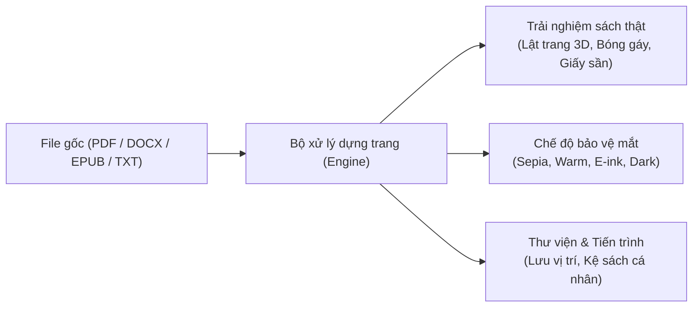
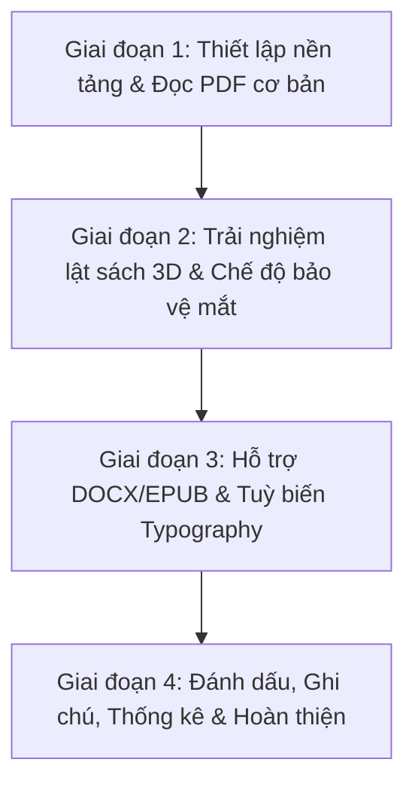

# KẾ HOẠCH PHÁT TRIỂN ỨNG DỤNG ĐỌC SÁCH CHUYÊN NGHIỆP: "REALBOOK READER"

---

## 1. TỔNG QUAN DỰ ÁN & ĐỊNH HƯỚNG TRẢI NGHIỆM

Ứng dụng hướng tới mục tiêu mang lại **cảm giác đọc như một cuốn sách giấy thật** (Skeuomorphic & Sensory Reading Experience) kết hợp với **ngôn ngữ thiết kế tối giản, hiện đại (Zen/Minimalism)** giúp người đọc hoàn toàn đắm chìm vào nội dung mà không bị phân tâm bởi các thanh công cụ hay thao tác phức tạp.



---

## 2. LÀM RÕ ĐẶC TÍNH ĐỊNH DẠNG FILE & CHIẾN LƯỢC XỬ LÝ TYPOGRAPHY

> [!IMPORTANT]
> **Điểm kỹ thuật quan trọng về định dạng PDF vs DOCX/EPUB/TXT:**
>
> - **File PDF** có bản chất là **Fixed-Layout** (bố cục cố định theo toạ độ điểm ảnh và font đã nhúng sẵn). Do đó, PDF mặc định sẽ không thể tự động đổi font hay cỡ chữ như file văn bản thông thường mà không phá vỡ cấu trúc trang.
> - **File DOCX, EPUB, TXT, Markdown** là **Reflowable** (dòng chữ tự động chảy theo kích thước khung nhìn).

Để giải quyết triệt để yêu cầu chỉnh font chữ/cỡ chữ trên cả PDF, ứng dụng sẽ cung cấp **2 chế độ hiển thị linh hoạt**:

1. **Chế độ Sách Thật (Realistic Book View - Mặc định cho PDF & EPUB):**
   - Giữ nguyên dàn trang gốc chuẩn in ấn của tác phẩm.
   - Thao tác phóng to/thu nhỏ (Zoom thông minh) mà vẫn giữ hiệu ứng mở 2 trang đôi và bóng gáy sách.
2. **Chế độ Tinh Gọn / Tái Dàn Trang (Zen Reflow Reader):**
   - Trích xuất nội dung văn bản (Text extraction) từ PDF hoặc render trực tiếp DOCX/EPUB.
   - Cho phép toàn quyền đổi **Font chữ (Bookerly, Merriweather, Georgia, Literata...)**, **Cỡ chữ**, **Khoảng cách dòng (Line height)**, **Lề trang (Margins)** và căn lề đều hai bên (Justify).

---

## 3. BẢNG CHI TIẾT TÍNH NĂNG (YÊU CẦU + ĐỀ XUẤT BỔ SUNG)

### 3.1. Nhóm tính năng Cốt lõi (Theo yêu cầu)

| STT   | Tính năng                        | Chi tiết thực hiện                                                                                                                                                                                                                                                                                                         |
| :---- | :------------------------------- | :------------------------------------------------------------------------------------------------------------------------------------------------------------------------------------------------------------------------------------------------------------------------------------------------------------------------- |
| **1** | **Mở file từ máy**               | Hỗ trợ kéo - thả (Drag & Drop) hoặc mở qua hộp thoại file. Hỗ trợ **PDF, DOCX, EPUB, TXT, MOBI, MD**.                                                                                                                                                                                                                      |
| **2** | **Kệ sách & Thư viện (Library)** | Hiển thị danh sách sách đang đọc với bìa sách thực tế, thanh tiến độ %, ngày đọc gần nhất, gắn thẻ (Thể loại/Yêu thích).                                                                                                                                                                                                   |
| **3** | **Lưu tiến trình & Đọc tiếp**    | Tự động ghi nhớ trang đang đọc đến từng mili-giây. Khi bấm vào sách trong thư viện, lập tức lật mở ngay đến đúng trang trước đó.                                                                                                                                                                                           |
| **4** | **Chế độ ánh sáng & Bảo vệ mắt** | 5 bộ theme màu giấy chuyên dụng: <br/>- **Paper White:** Trắng ngà tự nhiên.<br/>- **Sepia Classic:** Giấy vàng ấm phong cách sách cổ điển.<br/>- **Warm Amber:** Lọc ánh sáng xanh ban đêm.<br/>- **E-Ink Mode:** Đơn sắc xám dịu mắt như máy đọc sách Kindle.<br/>- **OLED Dark:** Nền đen mực sâu tiết kiệm năng lượng. |
| **5** | **Giao diện Tối giản (Zen UI)**  | Toàn màn hình (F11), tự động ẩn các thanh công cụ điều khiển khi người dùng đang đọc. Chỉ hiển thị lại khi rê chuột lên mép màn hình hoặc bấm phím tắt.                                                                                                                                                                    |
| **6** | **Tùy biến Typography**          | Tuỳ chỉnh Font Family, Font Size (12px - 36px), Line Spacing (1.2 - 2.2), Page Margins, Text Alignment (căn giữa).                                                                                                                                                                                                         |

---

### 3.2. Nhóm tính năng Đề xuất Bổ sung (Nâng tầm trải nghiệm sách thật)

> [!TIP]
> Các tính năng dưới đây tạo nên sự khác biệt vượt trội so với các phần mềm đọc PDF thông thường như Foxit Reader hay Adobe Acrobat:

- **1. Hiệu ứng lật trang vật lý chân thực (Realistic 3D/2D Page Flip):**
  - Hiệu ứng cong trang giấy khi rê chuột kéo góc trang (Page curl).
  - Độ bóng đổ (Shadow & Depth) ở rãnh gáy sách giữa 2 trang tạo cảm giác như một cuốn sách bìa cứng đang mở rộng.
  - Chuyển đổi linh hoạt giữa: **Xem 2 trang đôi (Double Spread)** trên màn hình lớn và **Xem 1 trang (Single Page)** trên màn hình hẹp/dọc.
- **2. Âm thanh lật trang tự nhiên (Paper Flip Sound):**
  - Hiệu ứng âm thanh sột soạt nhẹ nhàng khi lật trang (có nút bật/tắt nhanh).
- **3. Dây đánh dấu trang ruy-băng (Ribbon Bookmark):**
  - Biểu tượng ruy-băng thả xuống từ đỉnh gáy sách, cho phép bấm để đánh dấu trang nhanh như sách thật.
- **4. Tô sáng & Viết ghi chú bên lề (Highlight & Margin Notes):**
  - Đánh dấu đoạn văn bản bằng các màu bút highlight cổ điển (Vàng nhạt, Xanh pastel, Cam đào).
  - Gắn sticky note hoặc viết ghi chú bên lề trang sách.
- **5. Mục lục tương tác (Table of Contents / Navigation Outline):**
  - Nhận diện mục lục có sẵn của PDF/EPUB, cho phép nhảy nhanh đến từng chương/tiết mục.
- **6. Tra từ điển & Dịch thuật nhanh (Quick Dictionary & Translation):**
  - Bôi đen một từ/câu để hiển thị popup giải nghĩa hoặc dịch ngay tại chỗ (rất hữu ích khi đọc tài liệu chuyên ngành hoặc sách ngoại ngữ).
- **7. Thống kê thói quen đọc (Reading Analytics):**
  - Theo dõi tốc độ đọc trung bình (phút/trang), số trang đã đọc trong ngày/tuần, chuỗi ngày duy trì thói quen đọc (Reading Streak).
- **8. Tìm kiếm nội dung tốc độ cao (Instant In-Book Search):**
  - Tìm kiếm từ khóa trong sách với highlight trực tiếp vị trí xuất hiện trên trang.

---

## 4. ĐỀ XUẤT KIẾN TRÚC KỸ THUẬT (TECH STACK)

Để đảm bảo hiệu năng cao, mở file PDF hàng trăm MB mượt mà và chạy độc lập trên máy tính (Desktop App), phương án kiến trúc tối ưu nhất:

```
┌─────────────────────────────────────────────────────────────┐
│                       ELECTRON DESKTOP                      │
│                                                             │
│  ┌───────────────────────────────────────────────────────┐  │
│  │                    UI: REACT 19 + TAILWIND            │  │
│  │  - Zen Mode Toolbar         - Shelf / Library Grid    │  │
│  │  - Book Spine & Textures    - Settings & Typography   │  │
│  └──────────────────────────┬────────────────────────────┘  │
│                             │                               │
│  ┌──────────────────────────┴────────────────────────────┐  │
│  │                     READING ENGINES                   │  │
│  │  - StPageFlip / Page-Flip Canvas (Lật trang chân thực)│  │
│  │  - Mozilla PDF.js (Dựng trang PDF siêu nét)           │  │
│  │  - Mammoth.js (DOCX) + Epub.js (EPUB)                 │  │
│  └──────────────────────────┬────────────────────────────┘  │
│                             │                               │
│  ┌──────────────────────────┴────────────────────────────┐  │
│  │                   LOCAL STORAGE / DB                  │  │
│  │  - SQLite / Lowdb / IndexedDB: Lưu tiến trình,         │  │
│  │    bookmarks, highlights, recent files                │  │
│  └───────────────────────────────────────────────────────┘  │
└─────────────────────────────────────────────────────────────┘
```

- **Runtime:** **Electron** (chạy trực tiếp trên Windows như app desktop độc lập, tương thích tuyệt đối với môi trường Node.js hiện có) hoặc **Web Desktop App** (Vite + React) có thể chạy cả trên trình duyệt và đóng gói Electron.
- **Frontend & Giao diện:** **React + TypeScript + Tailwind CSS + Lucide Icons**.
- **Hiệu ứng lật trang sách:** **Page-Flip Engine (StPageFlip)** kết hợp bóng đổ gradient CSS 3D.
- **PDF Core:** **Mozilla PDF.js** (chuẩn công nghiệp thế giới, hỗ trợ render canvas độ phân giải cao chống vỡ hạt).
- **Định dạng khác:** **Mammoth.js** (chuyển đổi DOCX sang chuẩn HTML sạch), **Epub.js** cho sách điện tử.
- **Lưu trữ dữ liệu:** **Local IndexedDB / LocalStorage** (lưu 100% offline trên máy người dùng, bảo mật tuyệt đối, không gửi dữ liệu ra ngoài).

---

## 5. BẢN THẢO TRẢI NGHIỆM GIAO DIỆN (UI/UX CONCEPT)

### Màn hình 1: Kệ sách Thư viện (Library View)

- Nền gam màu tối giản (Warm Gray / Cream).
- Kệ sách hiển thị bìa 3D có độ dày gáy sách.
- Thẻ thông tin dưới mỗi cuốn sách: Tên tác giả, Tên sách, Thanh tiến độ màu hổ phách (Ví dụ: `68% - Trang 142/208`), nút "Đọc tiếp".
- Nút "Thêm sách mới" nổi bật kéo-thả file trực tiếp.

### Màn hình 2: Bàn đọc sách (Reading Workspace)

- **Khu vực trung tâm:** Cuốn sách mở rộng với 2 trang bên cạnh nhau (hoặc 1 trang theo tuỳ chọn), có viền trang giấy hơi sần, rãnh gáy đổ bóng nhẹ.
- **Thanh điều khiển Zen (Floating Bar):**
  - Tự động ẩn sau 3 giây không rê chuột.
  - Khi rê chuột lên đỉnh hoặc đáy màn hình, thanh mờ thủy tinh (Frosted Glass) hiện ra tinh tế:
    - _Nút Mục lục (Outline)_
    - _Bộ chọn Chế độ sáng (White / Sepia / Dark / E-ink)_
    - _Bật/Tắt chế độ 2 trang / 1 trang_
    - _Menu Typography (Đổi font chữ, cỡ chữ, dãn dòng)_
    - _Nút Toàn màn hình (Zen Fullscreen)_
- **Thanh tiến trình đọc dưới đáy:**
  - Hiển thị thanh trượt mảnh, số trang hiện tại / tổng trang, ước lượng thời gian còn lại của chương.

---

## 6. LỘ TRÌNH TRIỂN KHAI THEO GIAI ĐOẠN



1. **Giai đoạn 1 (Core Foundation):**
   - Khởi tạo khung dự án ứng dụng (Vite + React + Tailwind + TypeScript).
   - Module mở file cục bộ (hộp thoại chọn file & kéo thả).
   - Tích hợp PDF.js render trang với chất lượng sắc nét.
   - Cơ chế lưu trữ tiến trình đọc (IndexedDB/Local persistence) và danh sách sách gần đây.

2. **Giai đoạn 2 (Realistic Sensory Experience & Eye Comfort):**
   - Tích hợp Engine lật trang sách (2 trang mở song song, hiệu ứng lật trang cuốn góc mượt mà).
   - Đổ bóng rãnh gáy sách (Spine depth shadow) và texture giấy.
   - Thêm bộ lọc màu ánh sáng: Sepia, Warm, E-ink, Dark Mode, chỉnh độ sáng.
   - Hiệu ứng âm thanh lật trang sột soạt (tùy chọn bật/tắt).

3. **Giai đoạn 3 (Reflow Typography & Multi-format):**
   - Hỗ trợ thêm DOCX, EPUB, TXT.
   - Trình điều khiển cỡ chữ, dãn dòng, lề trang, bộ font chuyên đọc sách (Merriweather, Bookerly, Serif).
   - Chế độ Zen Mode / Fullscreen tự động ẩn thanh công cụ.

4. **Giai đoạn 4 (Advanced Features & Polish):**
   - Bookmark dây ruy-băng, Highlight đoạn văn bản, Ghi chú bên lề.
   - Mục lục sách tương tác, tìm kiếm nhanh nội dung.
   - Đóng gói ứng dụng chạy mượt mà trên desktop.
